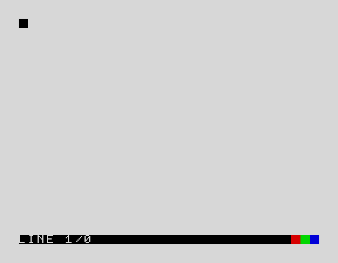
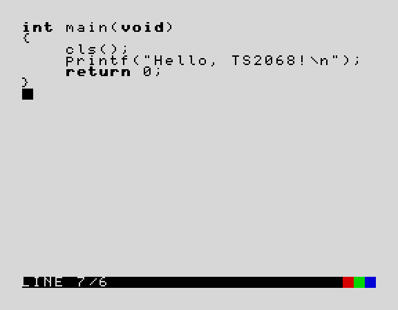
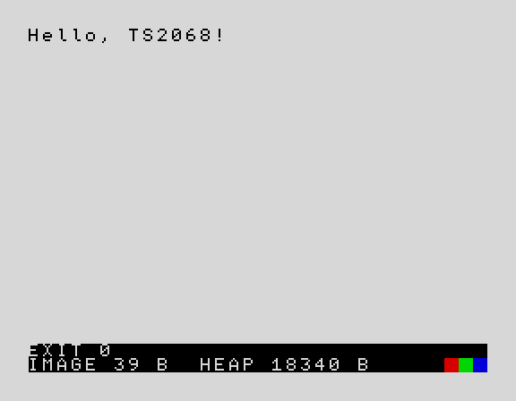

# Running Leap-C in an emulator

Leap-C is a pair of replacement ROMs for the Timex Sinclair 2068: a C editor and compiler instead of TS2068 BASIC. To try it you need an emulator of the TS2068 and the ROM files from the emulator pack (`leapc-1.0.0-beta.2-emulators.zip`). This page tells you how to set up each emulator on Windows, macOS and Linux, what a correct start looks like, how to type C on a PC keyboard, and how to use tapes.

**Which emulator?**

| Emulator | Version | Status for the beta | Windows | macOS | Linux |
|---|---|---|---|---|---|
| **Fuse** | **1.9.1** | **recommended**: qualified, works unmodified | ready-made build | Fuse for macOS 1.9.1 (a separate port, not checked by us) | build from source (steps below) |
| **ZEsarUX** | **13.0 with a small patch** | qualified, but **only with the patch**: the downloadable 13.0 shows a blank screen | not practical (use Fuse) | build from source (steps below, not checked by us) | build from source (steps below) |
| TSRun (in a web browser) | current | courtesy: no installation, but **tapes do not load** | any browser | any browser | any browser |
| Anything else (EightyOne, other versions of Fuse or ZEsarUX, ...) | — | untested: reports welcome | | | |

Leap-C was qualified on ZEsarUX 13.0 (with the patch) and Fuse 1.9.1 with thousands of automated tests. It has **not** been run on a physical TS2068 yet. The beta's other guides: [USER_GUIDE.md](USER_GUIDE.md) (using Leap-C) and [BETA_TESTING.md](BETA_TESTING.md) (what to try and how to report).

## Contents

1. [The files](#1-the-files)
2. [Fuse 1.9.1](#2-fuse-191-recommended)
3. [ZEsarUX 13.0 with the patch](#3-zesarux-130-with-the-exrom-patch)
4. [TSRun in a browser](#4-tsrun-in-a-web-browser)
5. [What a correct start looks like](#5-what-a-correct-start-looks-like)
6. [The keyboard on a PC](#6-the-keyboard-on-a-pc)
7. [Tapes](#7-tapes)
8. [50 Hz and 60 Hz](#8-50-hz-and-60-hz)
9. [Troubleshooting](#9-troubleshooting)
10. [How these instructions were checked](#10-how-these-instructions-were-checked)

## 1. The files

Unzip the emulator pack anywhere. It holds:

| File | Size | What it is | Used by |
|---|---:|---|---|
| `roms/leapc_home.bin` | 16,384 B | the HOME ROM (the TS2068's system ROM) | Fuse: ROM 0 |
| `roms/leapc_exrom.bin` | 8,192 B | the EXROM (the TS2068's extension ROM) | Fuse: ROM 1 |
| `roms/leapc_zesarux.bin` | 24,576 B | the HOME ROM followed by the EXROM, in one file | ZEsarUX: `--romfile` |
| `tapes/examples/exNN.tap`, `.tzx` and `ugNN.tap`, `.tzx` | | the example programs of `EXAMPLES.md` (`exNN`) and of `USER_GUIDE.md` (`ugNN`); `TAPES.md` gives each one's tape name and source | `LOAD ""` |
| `tapes/checks/hN_name.tap`, `.tzx` | | the hardware check programs (`TAPES.md`) | `LOAD ""` |
| `libs/shapes.tap`, `.tzx`, `shapes.asm` | | the example library and its source | `LIB "shapes"` |
| `SHA256SUMS` | | the SHA-256 of every file | checking the download |

The ROM files are not interchangeable: Fuse needs the two separate files, ZEsarUX the combined one. The beta's ROMs have these SHA-256 hashes (put them in every report):

| File | SHA-256 |
|---|---|
| `leapc_home.bin` | `043becf4b2e58e9783ef83b8188648214ed6a84e83a13709458439385df5fba5` |
| `leapc_exrom.bin` | `97fe95236ff16b7ccb1c5e138d228d67ca25bf31d7b86bdbd15995c85ac207e7` |
| `leapc_zesarux.bin` | `9cc679793a1f855f7ddcc2d99113e2730bd45c37e7204ea91df0d8f8e4b5af04` |

To check them, in the pack's folder: Linux `sha256sum -c SHA256SUMS`; macOS `shasum -a 256 -c SHA256SUMS`; Windows (PowerShell) `Get-FileHash roms\*.bin` and compare by eye.

**Use full (absolute) paths** to the ROM files on the command line. Both emulators look for a relative name in their own folders first.

## 2. Fuse 1.9.1 (recommended)

Fuse runs the TS2068 at its real 60 Hz and plays tapes as a signal, the way Leap-C's own tape code reads them. It needs no changes.

### 2.1 Getting Fuse 1.9.1

Use **1.9.1**. Fuse 1.9.2 and 1.10.0 are newer and untested with Leap-C; the 1.6.0 packaged by most Linux distributions is untested too.

- **Windows:** from [SourceForge, fuse 1.9.1](https://sourceforge.net/projects/fuse-emulator/files/fuse/1.9.1/), download `fuse-1.9.1-win32.zip` (unzip it anywhere) or `fuse-1.9.1-win32-setup.exe` (an installer). Fuse is `fuse.exe` in that folder. *(Not checked by us on Windows.)*
- **macOS:** Fuse on the Mac is a separate port, **Fuse for macOS**, whose version 1.9.1 is at [SourceForge, fuse-for-macosx 1.9.1](https://sourceforge.net/projects/fuse-for-macosx/files/fuse-for-macosx/1.9.1/) (`FuseForMacOS-1.9.1.zip`). Its menus and preferences are its own, not the ones below: choose the machine **Timex TS2068**, give it `leapc_home.bin` and `leapc_exrom.bin` as the TS2068's two ROMs, and turn off tape traps. macOS may refuse to open an app from an unidentified developer the first time: Control-click the app, choose **Open**, and confirm. *(Not checked by us: please report what you find.)*
- **Linux:** build it from the source tarballs. Fuse 1.9.1 needs **libspectrum 1.6.3** (or a later 1.6.x). With a C compiler, `make`, `pkg-config` and the development packages of SDL2, libpng, libxml2, zlib, libbz2 and libaudiofile installed (on Debian or Ubuntu: `sudo apt install build-essential pkg-config libsdl2-dev libpng-dev libxml2-dev zlib1g-dev libbz2-dev libaudiofile-dev`), this installs both in `~/fuse-1.9.1` without touching the rest of the system:

  ```sh
  P=$HOME/fuse-1.9.1
  curl -fsSLO https://downloads.sourceforge.net/project/fuse-emulator/libspectrum/1.6.3/libspectrum-1.6.3.tar.gz
  curl -fsSLO https://downloads.sourceforge.net/project/fuse-emulator/fuse/1.9.1/fuse-1.9.1.tar.gz
  tar xzf libspectrum-1.6.3.tar.gz && tar xzf fuse-1.9.1.tar.gz
  (cd libspectrum-1.6.3 && ./configure --prefix=$P && make && make install)
  (cd fuse-1.9.1 && PKG_CONFIG_PATH=$P/lib/pkgconfig ./configure --prefix=$P --with-sdl && make && make install)
  export LD_LIBRARY_PATH=$P/lib     # each time before running $P/bin/fuse
  $P/bin/fuse --version             # "... (Fuse) version 1.9.1."
  ```

  `--with-sdl` builds Fuse's SDL interface (with SDL2): its menus are drawn in the Fuse window and open with **F1**. Without it, `configure` looks for GTK 3 (`libgtk-3-dev`) and builds the GTK interface, with a menu bar. Arch Linux's AUR also packages Fuse (check that its version is 1.9.1). *(Checked by us on Pop!_OS 24.04, x86-64.)*

### 2.2 Starting Leap-C from the command line

Linux and macOS (one line; replace `/path/to/pack` with the folder you unzipped):

```sh
fuse --machine ts2068 --rom-ts2068-0 /path/to/pack/roms/leapc_home.bin --rom-ts2068-1 /path/to/pack/roms/leapc_exrom.bin --no-traps --no-auto-load
```

Windows (Command Prompt, in Fuse's folder):

```bat
fuse.exe --machine ts2068 --rom-ts2068-0 "C:\path\to\pack\roms\leapc_home.bin" --rom-ts2068-1 "C:\path\to\pack\roms\leapc_exrom.bin" --no-traps --no-auto-load
```

Fuse starts in Leap-C's editor after a short chord (section 5). Options given on the command line are used for that run only; section 2.3 makes them permanent.

### 2.3 Setting it up through the menus

Fuse's menus are the same on Linux and Windows. On the SDL build press **F1** to open them (Esc goes back a level); the GTK and Windows builds have a menu bar.

1. **Options → Select ROMs → Machine ROMs → Timex TS2068...**: set **ROM 0** to `leapc_home.bin` and **ROM 1** to `leapc_exrom.bin` (full paths).
2. **Options → Media...**: untick **Use tape traps** and **Auto-load media**. Leave the others (**Detect loaders**, **Fastloading**, **Accelerate loaders**) as they are: they were on in every test.
3. **Machine → Select...** (F9): choose **Timex TS2068**.
4. **Options → Save**: keeps these settings for the next start (in `~/.config/fuse-emulator/fuserc` on Linux, `fuse.cfg` in your user folder on Windows).
5. **Machine → Hard reset...**: starts Leap-C.

### 2.4 The settings Leap-C needs, and why

| Setting | Leap-C needs | Why |
|---|---|---|
| Machine | **Timex TS2068** (`--machine ts2068`) | `2068` is the Portuguese TC2068, a different machine; Leap-C is built for the TS2068 |
| ROM 0 / ROM 1 | `leapc_home.bin` / `leapc_exrom.bin` | the two ROM sockets. Fuse checks the sizes (16,384 and 8,192 B); a wrong file makes it start the stock TS2068 ROM instead (section 9) |
| Use tape traps | **off** (`--no-traps`) | a trap replaces the stock ROM's tape routine with a direct copy from the tape file. Leap-C has its own tape routines and its own tape format, so it must hear the tape as a signal |
| Auto-load media | **off** (`--no-auto-load`) | auto-load types the stock ROM's `LOAD ""` keystrokes, which mean nothing to Leap-C. (With custom ROMs Fuse skips it anyway) |
| Detect loaders | on (default) | Fuse starts and stops the tape when it sees Leap-C's loader listen to it, so a tape plays by itself after `LOAD ""` (section 7) |
| Sound | on (default) | the TS2068's AY sound chip plays the start chord, `beep()` and `sound()` |

## 3. ZEsarUX 13.0 with the EXROM patch

**The ZEsarUX 13.0 you can download does not run Leap-C: it shows a blank screen.** On a real TS2068 the 8 KB EXROM appears in every 8 KB slot of memory that selects it, because the machine does not decode its upper address lines. Leap-C runs its editor, compiler services and tape headers from the EXROM in the slot at `$C000`. ZEsarUX 13.0 maps the EXROM into the first two slots only, so there Leap-C finds nothing. A small patch to one file, written for Leap V2 (which needs the same), fixes ZEsarUX's EXROM mapping. Every ZEsarUX test of Leap-C ran on 13.0 with this patch. It is being reported to ZEsarUX's author; until a ZEsarUX release includes it, you have to build ZEsarUX yourself, or use Fuse.

### 3.1 Building ZEsarUX 13.0 with the patch

**Linux** (needs `git`, a C compiler, `make`, and the X11 and sound development packages; on Debian or Ubuntu: `sudo apt install build-essential git libx11-dev libxext-dev libxxf86vm-dev libpulse-dev libasound2-dev`; `./configure` lists what it found, and this build used X11 for the window and PulseAudio or ALSA for sound):

```sh
git clone https://github.com/chernandezba/zesarux.git
cd zesarux
git checkout ZEsarUX-13.0
curl -fsSLO https://raw.githubusercontent.com/nchiker/2068-Leap/v2.0.2-emu.1/patches/0001-zesarux-mirror-ts2068-exrom.patch
git apply 0001-zesarux-mirror-ts2068-exrom.patch
cd src
./configure && make
./zesarux --version               # "ZEsarUX 13.0 - ..."
```

Run ZEsarUX from that `src` folder (`./zesarux ...`), or `make install` it. *(Checked by us on Pop!_OS 24.04, x86-64: built, and Leap-C starts.)*

**macOS:** the same steps in Terminal, after installing Apple's command-line tools (`xcode-select --install`). ZEsarUX's own build documentation (`INSTALL` in the source) covers the details. *(Not checked by us.)*

**Windows:** building ZEsarUX on Windows needs a MinGW tool chain and is beyond this guide. Use Fuse.

### 3.2 Starting Leap-C from the command line

From ZEsarUX's folder:

```sh
./zesarux --noconfigfile --machine TS2068 --romfile /path/to/pack/roms/leapc_zesarux.bin --noautoload
```

- `--noconfigfile` must come **first**. It starts ZEsarUX without the settings it saved last time (in `~/.zesaruxrc`), so an old machine or ROM choice cannot get in the way.
- `--machine TS2068` (TC2068 is a different machine), `--romfile` the **combined** file (24,576 B).
- `--noautoload`: see 3.4.

### 3.3 Setting it up through the menus

ZEsarUX draws its own menus in its window: **F5** opens the main menu, Esc closes a menu. Some items appear only with **Settings → Advanced menu items** ticked.

1. **Settings → Advanced menu items**: tick it.
2. **Machine → Timex Sinclair → TS2068**.
3. **Machine → Custom rom**: tick it, then **Rom file**: choose `leapc_zesarux.bin`, then **Reset machine**.
4. **Settings → Hardware → Storage → Autoload medium**: untick it.
5. **Settings → Configuration file → Save configuration**: keeps these settings for the next start.

### 3.4 The settings Leap-C needs, and why

| Setting | Leap-C needs | Why |
|---|---|---|
| Machine | **TS2068** | Leap-C is built for the TS2068 |
| ROM | `leapc_zesarux.bin`, the combined file | ZEsarUX reads 16,384 B of HOME ROM, then 8,192 B of EXROM, from one file |
| Autoload medium | **off** (`--noautoload`) | with autoload on, inserting a tape resets the machine, and ZEsarUX types the stock ROM's `LOAD ""` keystrokes when the processor reaches a stock ROM address. In Leap-C that address is in the middle of the compiler: the keystrokes would arrive at random moments as junk. Type `LOAD ""` yourself |
| Tapes | through **Input Real Tape** (section 7) | the ordinary tape input relies on ZEsarUX's tape traps, which only work with the stock ROM's tape routines; Leap-C never runs them, so a tape put there is never read. The real-tape input plays the tape as a signal, which Leap-C's own loader reads. (ZEsarUX has no switch for the TS2068's traps, and with Leap-C they never fire) |
| Joystick emulation | **Cursor&Shift** (the default) | makes the PC's arrow keys the cursor keys (section 6) |

ZEsarUX's sound is on by default (the AY chip: the start chord, `beep()`, `sound()`).

## 4. TSRun in a web browser

[TSRun](https://github.com/josef-jelinek/TSRun) is a TS2068 emulator that runs in a web browser. **[nchiker.github.io/TSRun/?rom=leapc](https://nchiker.github.io/TSRun/?rom=leapc)** starts it with this beta's ROMs: nothing to install. Click the page or press a key once to let the browser play sound. It has an on-screen TS2068 keyboard, and the PC keys of section 6.

**Limitation: tapes do not load in TSRun.** TSRun starts a tape when it sees the stock ROM's loader, and stops it again a tenth of a second later because Leap-C's loader is not where the stock one is; `LOAD` and `LIB` then end in `LOAD FAILED`. This is TSRun's [issue #3](https://github.com/josef-jelinek/TSRun/issues/3) (reported for Leap V2, which has the same loader). TSRun also cannot record a `SAVE`. Use it to type and run programs; use Fuse or ZEsarUX for tapes and libraries. TSRun runs the TS2068 at 60 Hz.

## 5. What a correct start looks like

1. You hear a short chord (C, E and G, played one after another and held: just under a second).
2. The screen is white with a black **status row** at the bottom: `LINE 1/0` on the left (the cursor is on line 1 of a program with 0 lines) and three coloured squares, red, green and blue, on the right. A black block is the cursor. The border is white.



This is the editor; there is no "OK" prompt or copyright message. Type a program (see [USER_GUIDE.md](USER_GUIDE.md) §1); C keywords turn bold when you leave a line:



and `RUN` on the empty last line compiles and runs it:



(The pictures are drawn from the emulator's screen memory; the emulator adds its own window border.)

**A wrong setup** looks like one of these (section 9 says what to do):

| What you see | Usual cause |
|---|---|
| a blank screen (white, black or with random lines) and no chord | ZEsarUX without the patch; the HOME ROM alone given to ZEsarUX; the ROM files swapped or wrong |
| the TS2068's own BASIC copyright screen | Fuse could not use the Leap-C files (wrong path or wrong size: Fuse says so in a message) and started its stock ROM |
| a Fuse message "ROM '...' is N bytes long; expected M bytes" | a file given to the wrong ROM slot |
| the editor appears but keys type the wrong characters | see section 6 |

## 6. The keyboard on a PC

The TS2068 has 40 keys, two of them shift keys: **CAPS SHIFT** (capitals and the editing keys) and **SYMBOL SHIFT** (punctuation). Leap-C uses the TS2068's own key positions, so a PC key gives what the TS2068 key in the same place would; punctuation is typed with SYMBOL SHIFT and a letter or digit, as on the real machine.

| TS2068 key | Fuse | ZEsarUX | TSRun |
|---|---|---|---|
| CAPS SHIFT | Shift (either) | Shift (either) | Shift (either) |
| SYMBOL SHIFT | **Ctrl** or **Alt** (either) | **Ctrl** or **Alt** (either) | **Ctrl** (either) |
| ENTER | Enter | Enter | Enter |
| cursor left, down, up, right (CAPS SHIFT + 5, 6, 7, 8) | arrow keys | arrow keys | arrow keys |
| DELETE (CAPS SHIFT + 0) | Backspace | Backspace | Backspace |
| BREAK (CAPS SHIFT + SPACE) | Shift + Space | Shift + Space, or **Esc** | Shift + Space, or **Esc** |
| delete the line (CAPS SHIFT + 1) | Shift + 1, or **Esc** | Shift + 1 | Shift + 1 |
| insert a line (CAPS SHIFT + ENTER) | Shift + Enter | Shift + Enter | Shift + Enter |

**Esc differs:** in Fuse, Esc is CAPS SHIFT + 1, which in Leap-C's editor **deletes the line you are on**. In ZEsarUX and TSRun, Esc is BREAK. In ZEsarUX, F5 opens the emulator's menu; in Fuse's SDL build, F1 does.

**Typing C.** Hold SYMBOL SHIFT (Ctrl) and press the key:

| Character | Key | | Character | Key | | Character | Key |
|---|---|---|---|---|---|---|---|
| `[` | **Y** | | `{` | **F** | | `\|` | **S** |
| `]` | **U** | | `}` | **G** | | `~` | **A** |
| `^` | **H** | | `\` | **D** | | `_` | 0 |
| `!` | 1 | | `@` | 2 | | `#` | 3 |
| `$` | 4 | | `%` | 5 | | `&` | 6 |
| `'` | 7 | | `(` | 8 | | `)` | 9 |
| `"` | P | | `;` | O | | `:` | Z |
| `<` | R | | `>` | T | | `?` | C |
| `=` | L | | `+` | K | | `-` | J |
| `*` | B | | `/` | V | | `,` | N |
| `.` | M | | | | | | |

The first eight (`[ ] { } | ~ ^ \`) are Leap-C's own: the TS2068 has no keys for them, and its key legends at those places show BASIC keywords. The rest are the TS2068's own SYMBOL SHIFT characters. Two-character operators are typed one character at a time (`<=` is SYMBOL SHIFT + R, then SYMBOL SHIFT + L).

**PC punctuation keys.** The emulators turn some PC punctuation keys into the TS2068 chord for you. Fuse does so for `, . / ; ' # - =` and the shifted characters `! $ ) * + : <`; ZEsarUX only for `, . -` (and the keypad's `+ / *`). Other PC punctuation keys, such as `[`, `]`, `\` or Shift + `9`, do nothing or type something else. **The SYMBOL SHIFT chords above always work.**

Capitals: Shift + the letter. Leap-C is case-sensitive, as C is (`Main` is not `main`); commands (`RUN`, `LIST`, ...) may be typed in either case.

## 7. Tapes

Leap-C keeps programs, data and libraries on cassette tape, as the TS2068 does. In an emulator a tape is a file: `.tzx` or `.tap`. Leap-C's tapes use the TS2068's standard tape signal but their own header (a version word), so the TS2068's BASIC and Leap-C refuse each other's tapes (`BAD TAPE VERSION`).

Everywhere below, Leap-C waits about 2 minutes for a tape; start the tape within that time. SPACE (or BREAK) stops a tape command.

### 7.1 Loading a program tape: `LOAD ""`

On the empty last line of the editor (after the last line of your program; `NEW` gives an empty program) type `LOAD ""` and press Enter. The status row shows `LOADING`. Then start the tape:

- **Fuse:** **Media → Tape → Open...** (F7) and choose the `.tzx` or `.tap`. Fuse starts the tape by itself as soon as Leap-C listens (Detect loaders). If it does not move, **Media → Tape → Play** (F8).
- **ZEsarUX:** in the main menu (F5), **Storage → Tape**, section **Input Real Tape**: **File** (choose the `.tzx` or `.tap`), tick **Inserted**, then tick **Playing**.

The status row shows `LOADING name` when the tape's header is found, then the report `LOADED name`. Press a key: the program is in the editor, which replaced the one before. Type `RUN`.

`LOAD "name"` loads only the tape called `name` (up to 10 characters), skipping others. A failure leaves your program as it was (`LOAD FAILED`, `BAD TAPE VERSION`, `BREAK`).

### 7.2 Loading the shapes library: `LIB "shapes"`

A library adds functions to C. Type `LIB "shapes"`, then start `libs/shapes.tzx` (or `.tap`) as in 7.1. The report is `LIBRARY shapes: 3 FUNCTIONS`. Now `circle(x, y, r)`, `box(x0, y0, x1, y1)` and `isqrt(n)` can be called like built-in functions; [USER_GUIDE.md](USER_GUIDE.md) §9 has an example. The library stays loaded through `NEW` and `LOAD`; `LIB` alone unloads it, and a reset clears it.

### 7.3 Saving: `SAVE "name"`, and loading it back

**Fuse** records the tape signal Leap-C sends:

1. **Media → Tape → Clear** (optional: starts an empty tape).
2. **Media → Tape → Record Start**.
3. In Leap-C, type `SAVE "myprog"` (a name of 1-10 characters) on the empty last line. The status row shows `SAVING myprog` for a few seconds, then the report `SAVED myprog`. Press a key.
4. **Media → Tape → Record Stop**.
5. **Media → Tape → Write...** (F6): save it as `myprog.tzx`. Use **.tzx**: a recording cannot be written as `.tap`.

To check it: type `VERIFY "myprog"`, then **Media → Tape → Open...** the same `.tzx` (F8 Play if needed): the report `VERIFIED myprog` means the tape holds exactly your program. To load it back later: `NEW`, `LOAD "myprog"`, and open the `.tzx`.

**ZEsarUX 13.0 cannot save Leap-C's tapes to a file.** Its tape output works only through its traps on the stock ROM's routines, which Leap-C does not use: `SAVE` completes (`SAVED name`), but no file is written. Use Fuse to test `SAVE`. **TSRun** cannot record either.

Programs can also save and load their own data with `tape_save()` and `tape_load()` ([USER_GUIDE.md](USER_GUIDE.md) §8): the same steps.

### 7.4 Making a tape from a C file on the PC

You can write a program in a text editor on the PC and make a tape of it with `tools/c2tape.py` from the Leap-C repository (it needs Python 3.11 or later, nothing else):

```sh
git clone https://github.com/nchiker/2068-Leap-C.git
cd 2068-Leap-C
python3 tools/c2tape.py myprog.c myprog.tzx
```

`LOAD ""` (or `LOAD "myprog"`) reads it. The tape's name is the file's name without `.c` (1-10 characters; `--name NAME` chooses another). Each line may hold up to 127 characters of printable ASCII (tabs become spaces, to every 8th column); a line that breaks these rules is refused with a message naming it. Use `.tap` instead of `.tzx` for a TAP file.

A library's tapes are made from its assembly source with `tools/lib2tape.py`, which also needs [sjasmplus](https://github.com/z00m128/sjasmplus) 1.23.1 (see [CONTRIBUTING.md](../CONTRIBUTING.md); the library interface is in `include/leapc_lib.inc` and the example is `libs/shapes.asm`):

```sh
python3 tools/lib2tape.py mylib.asm mylib.bin mylib.sym mylib.tap mylib.tzx mylib.wav
```

## 8. 50 Hz and 60 Hz

A real TS2068 shows 60 frames a second (it is an American machine), and so do Fuse and TSRun. **ZEsarUX 13.0 runs its TS2068 at 50 frames a second**, like a British Spectrum. Leap-C counts time in frames, so on ZEsarUX:

| | TS2068, Fuse, TSRun | ZEsarUX 13.0 |
|---|---|---|
| `frames()` counts per second | 60 | 50 |
| `pause(60)` lasts | 1 s | 1.2 s |
| `beep(30, 0)` lasts | 0.5 s | 0.6 s |
| the start chord | about 0.9 s | about 1.1 s |

Programs run at the same speed per instruction on both; only time measured in frames differs. Report a timing problem with the emulator's name.

## 9. Troubleshooting

**A blank or garbled screen, no chord.**

- ZEsarUX: is it built with the patch (section 3)? The downloadable 13.0 always shows this. Is `--romfile` the combined `leapc_zesarux.bin` (24,576 B), with a full path? Did you start with `--noconfigfile`?
- Fuse: are ROM 0 and ROM 1 the right way round (HOME 16 KB is ROM 0)? Is the machine **Timex TS2068**? After changing ROMs: **Machine → Hard reset**.
- Check the files' hashes (section 1).

**The TS2068's BASIC appears instead of Leap-C.** Fuse could not read a Leap-C file and used its own ROM: check the paths (absolute) and Fuse's message.

**A tape will not load** (`LOADING` stays, or `LOAD FAILED` after about 2 minutes).

- Fuse: **Options → Media**: **Use tape traps** must be off. Is the tape playing (F8)? Did you open the right file?
- ZEsarUX: the tape must be in **Input Real Tape** with **Inserted** and **Playing** ticked, not in the ordinary tape **Input**. Autoload off.
- TSRun: tapes do not load (section 4).
- A tape made for TS2068 BASIC or Leap V2 gives `BAD TAPE VERSION`: Leap-C reads only its own tapes.
- `LOAD "name"` waits for that name only: try `LOAD ""`.

**Keys do nothing, or type the wrong thing.**

- Click the emulator's window first (it must have the keyboard focus); in TSRun, click the page.
- After a report (`EXIT 0`, `SAVED ...`), Leap-C waits for a key to be **pressed after all keys are released**: let go of everything, then press a key.
- Punctuation: use SYMBOL SHIFT (Ctrl) chords (section 6), not the PC's punctuation keys.
- Fuse: Esc deletes the current line. ZEsarUX: F5 opens the menu; Esc closes it.
- A different keyboard layout (not US/UK) may move the PC keys the emulators translate; the letters, digits, Shift, Ctrl and arrows still work.
- ZEsarUX: arrow keys do nothing if joystick emulation was changed: **Settings → Hardware → Joystick**, set the emulated joystick to **Cursor&Shift**, or start with `--noconfigfile`.

**No sound.** Fuse: **Options → Sound... → Sound enabled**. TSRun: click the page once. Leap-C works without sound.

**Still stuck?** Open an issue ([BETA_TESTING.md](BETA_TESTING.md) says what to include).

## 10. How these instructions were checked

"Checked" means done on Pop!_OS 24.04 (Linux, x86-64), on 2026-10-22, with the beta's ROM hashes above. Nothing here was checked on Windows or macOS: those steps follow the emulators' own documentation and sources and are marked "not checked by us" where they differ from Linux.

| Procedure | How it was checked | Result |
|---|---|---|
| Fuse 1.9.1 built from the official tarballs (2.1) | the steps of 2.1, exactly, into a private prefix | builds, reports 1.9.1 |
| Fuse 1.9.1 unmodified runs Leap-C | `tools/fusetest.py` (the project's Fuse suite) on Fuse built from the official 1.9.1 tarball: boot, every key of the C character set, 39 typed programs, BREAK, frame counting, `SAVE` recorded and loaded back, a WAV, `LIB` | all pass |
| Fuse command line (2.2) | the suite starts Fuse with these options (`--machine ts2068 --rom-ts2068-0 ... --rom-ts2068-1 ... --no-traps --no-auto-load`, plus headless and speed options), Fuse's other settings at their defaults | as described |
| Fuse menu paths and labels (2.3, 7.1, 7.3) | read from Fuse 1.9.1's menu definitions (`menu_data.dat`, shared by its GTK, SDL and Windows builds) and its manual | not clicked through |
| Fuse tape steps (7.1, 7.3) | the suite performs them through Fuse's own tape functions: open, Fuse starts the tape itself, `LOAD ""`; record start, `SAVE`, record stop, write `.tzx`, load it back | pass |
| Fuse keys (6) | Fuse 1.9.1's keyboard table (`keyboard.c`, the SDL key map) and manual; the suite types through the emulated keyboard | Shift, Ctrl/Alt, arrows, Backspace, Esc mapping from the source |
| ZEsarUX: the downloadable 13.0 shows a blank screen (3) | ZEsarUX 13.0 built from its release tag, unmodified: Leap-C started, run for 20 million instructions | never reaches the editor, screen empty |
| ZEsarUX built with the patch (3.1) | the steps of 3.1, exactly (a fresh clone from GitHub, the patch from Leap V2's release tag) | builds; Leap-C starts in the editor |
| ZEsarUX command line, tapes, frame rate | the project's qualification runs ZEsarUX 13.0 with the patch, headless, with `--noconfigfile --machine TS2068 --romfile ...`; tapes through the real-tape input (`.tap` and `.tzx` made by `c2tape.py` included) | thousands of cases pass |
| ZEsarUX `SAVE` writes no file (7.3) | a program typed, `SAVE "zs"` with an output tape given (`--outtape`) | `SAVED zs`, no file written |
| ZEsarUX menu paths and labels (3.3, 7.1) | read from ZEsarUX 13.0's source (its menu definitions) | not clicked through |
| ZEsarUX keys (6) | ZEsarUX 13.0's keyboard handling in its source | from the source |
| ZEsarUX and the `.dck` cartridge | the build's `leapc_exrom.dck` given to ZEsarUX (stock and patched) | refused: ZEsarUX takes only DOCK-bank cartridges; the `.dck` is not in the beta |
| TSRun (4) | TSRun's emulation core, run headless with the beta's ROMs: start, a program typed through its keyboard matrix and `RUN`, `LOAD ""` of a `.tzx` and a `.tap` | editor and `RUN` work; tapes stop after 0.1 s (issue #3) |
| TSRun keys (6) | TSRun's keyboard table (`keyboard.js`) | from the source |
| The pictures (5) | rendered from the emulator's screen memory after a cold start, after typing, after `RUN` | as shown |
| `c2tape.py` (7.4) | `make test`'s cassette suite loads its `.tap` and `.tzx` on ZEsarUX; `make fuse` loads every corpus program from its tape on Fuse | pass |
